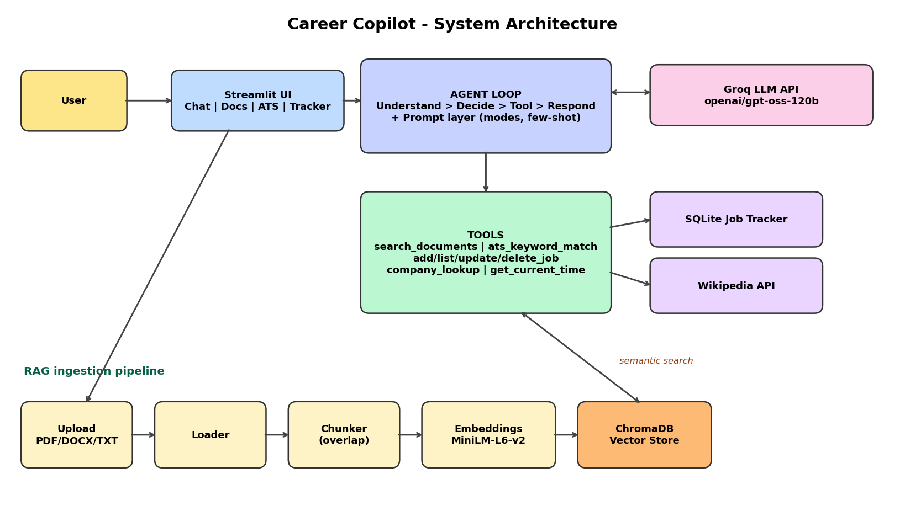
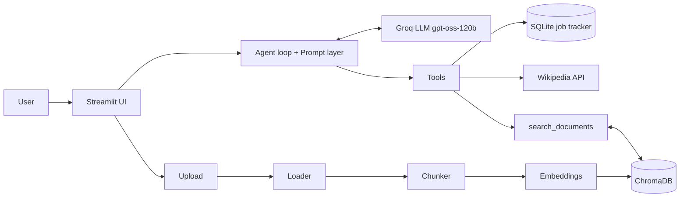

# 🚀 Career Copilot - GenAI Capstone

An AI career assistant that reviews your resume, matches it to job descriptions, coaches you for
interviews, writes cover letters and tracks your applications.

It combines every module of the course in one Streamlit app:

| Capstone requirement | Where it lives |
|---|---|
| **LLM API** | `copilot/llm.py` - Groq `openai/gpt-oss-120b`, retries with backoff, JSON mode |
| **Prompt engineering** | `copilot/prompts.py` - role prompts, 4 assistant modes, few-shot STAR feedback, constraints, JSON schema |
| **RAG** | `copilot/loader.py` > `chunker.py` > `vectorstore.py` - PDF/DOCX/TXT, overlapping chunks, MiniLM embeddings, ChromaDB, cited search |
| **Tools** | `copilot/tools.py` - document search, ATS match, job tracker (SQLite), company lookup (Wikipedia), time |
| **Agent** | `copilot/agent.py` - Understand > Decide > Use Tool > Process Result > Respond, step limit, destructive-action guard |
| **UI** | `app.py` - tabs: Copilot chat, Documents, ATS Match, Job Tracker, About |

## Architecture





## Quick start

```bash
python -m venv .venv
# Windows: .venv\Scripts\activate     Mac/Linux: source .venv/bin/activate
pip install -r requirements.txt
cp .env.example .env        # then paste your Groq key (https://console.groq.com/keys)
streamlit run app.py
```

1. Open **Documents**, click **Load sample resume + JD** (or upload your own files) - first run downloads the small embedding model.
2. **Copilot** tab: *"Review my resume against the Junior AI Engineer JD"*.
3. **ATS Match** tab: keyword score + structured AI feedback.
4. **Job Tracker** tab, or tell the agent: *"Add Google - ML Intern as Applied"*.

## Safety and reliability

- Tool allowlist; destructive tools (`delete_job`) blocked unless the user switches them on
- Max-step limit prevents runaway agent loops
- Tool errors are returned to the model as text so it can recover
- Prompts forbid inventing experience; answers are grounded in retrieved documents
- Network timeouts, output truncation, API retries, clear error messages
- `.env` and local databases are git-ignored

## Tests

```bash
python -m unittest discover -s tests -v
```
9 offline tests cover chunking, ATS matching, tool safety, job CRUD and the agent loop (with a mocked LLM).

## Limitations

- ATS score is a keyword heuristic, not a real ATS system
- The agent can still pick a wrong tool; always verify important output
- Free-tier rate limits may slow long sessions
- On Streamlit Cloud, uploaded data and the job tracker reset when the app restarts

## Tech stack
Python, Streamlit, Groq API (`openai/gpt-oss-120b`), ChromaDB, pypdf, python-docx, SQLite.
